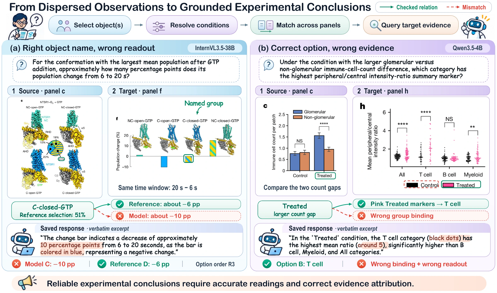

# CrossPanel: Exposing the Answer–Evidence Gap in Scientific Figure Understanding

[Paper on arXiv](https://arxiv.org/abs/2611.28641) · [Project page](https://lululualululu.github.io/CrossPanel/) · [Table 2 (CSV)](results/table-2.csv) · [BibTeX](citation.bib)

Zhengyang Lu\*, QianhongWen\*, Chenpeng Wang\*, Qiang Huang, Ziyang Ling, Huan Li, Chenziao, Yibo Qiu, and Xiaojie Cheng.

\*Equal contribution.

CrossPanel tests whether a model can follow the same experimental object and conditions across panels in a scientific figure. In the example below, Qwen3.5-4B selects the correct T-cell answer while attributing it to the wrong markers.

## Benchmark

| Evaluation | Scope | What is measured |
| --- | --- | --- |
| Main evaluation | 2,650 questions across 8 disciplines | Answer accuracy on 495 parallel and 2,155 dependent questions |
| Evidence audit | 251 questions × 15 models | Support for the stated object, condition, cross-panel binding, and local readout |
| Controlled interventions | 57 questions | Changes in accuracy and target readout with verified context or additional image tiles |

## Results

Across the 15 models, **8.42%–56.64% of correct answers** in the audit contain an explicit factual error. On the same 251 questions, DeepSeek V4.1 Flash scores higher than GPT-5.4 mini on answer accuracy (72.11% vs. 71.31%), while GPT-5.4 mini scores higher when the answer and all four facts must be correct (62.55% vs. 57.37%).

[Table 2](results/table-2.csv) contains all 15 rows from arXiv v1. Values are percentages. Parallel, Dependent, Macro, and Overall use the main evaluation. Macro gives equal weight to the two question types. The remaining columns use the audit: Joint requires a correct answer and support in all four dimensions. Error given correct uses only answer-correct responses as its denominator.

[Dataset construction](assets/pdfs/figure-2.pdf) · [Dataset composition](assets/pdfs/figure-3.pdf) · [Evidence audit](assets/pdfs/figure-4.pdf) · [Interventions](assets/pdfs/figure-5.pdf)

## Citation

[Cite the paper with BibTeX](citation.bib).

Scientific figure excerpts retain their original attributions. [Project-page icon credits](assets/icons/LICENSE.txt)
